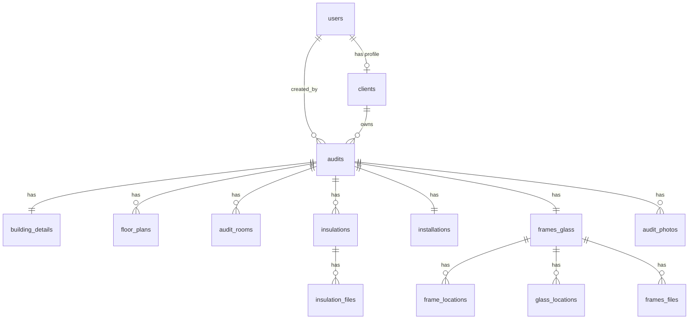

# Database Structure and Backend API Specification

This document defines a relational database structure and a RESTful backend API design matching the data structures and user roles present in the energy audit application.

---

## 1. Relational Database Schema (SQL/PostgreSQL)

### Table Definitions

#### 1. `users`
Stores system users and their authentication context.
* **Columns**:
  * `id` (UUID, Primary Key)
  * `email` (VARCHAR, Unique, Indexed)
  * `full_name` (VARCHAR)
  * `phone_number` (VARCHAR)
  * `role` (VARCHAR) — Enum: `CLIENT`, `BID_INTERN`, `BACK_OFFICE`, `INSPECTOR`
  * `created_at` (TIMESTAMP)
  * `updated_at` (TIMESTAMP)

#### 2. `clients`
Resident profiles mapping to residential addresses.
* **Columns**:
  * `id` (UUID, Primary Key)
  * `user_id` (UUID, Foreign Key → `users.id`, Nullable)
  * `full_name` (VARCHAR)
  * `email` (VARCHAR)
  * `phone` (VARCHAR)
  * `address` (VARCHAR)
  * `company_name` (VARCHAR, Nullable)
  * `advisor_name` (VARCHAR, Nullable)
  * `certificaathouder` (VARCHAR, Nullable)
  * `created_at` (TIMESTAMP)
  * `updated_at` (TIMESTAMP)

#### 3. `audits`
Represents an individual energy survey dossier.
* **Columns**:
  * `id` (UUID, Primary Key)
  * `client_id` (UUID, Foreign Key → `clients.id`, Indexed)
  * `inspector_id` (UUID, Foreign Key → `users.id`, Indexed)
  * `status` (VARCHAR) — Enum: `DRAFT`, `SUBMITTED`, `COMPLETED`
  * `created_at` (TIMESTAMP)
  * `updated_at` (TIMESTAMP)

#### 4. `building_details` (Algemeen)
General physical building parameters.
* **Columns**:
  * `audit_id` (UUID, Primary Key, Foreign Key → `audits.id`)
  * `building_type` (VARCHAR) — e.g., Detached house, Apartment
  * `position` (VARCHAR) — e.g., Detached, Corner
  * `location_roof_type` (VARCHAR) — e.g., Pitched roof, Flat roof
  * `number_of_floors` (INTEGER)
  * `start_floor` (VARCHAR) — e.g., "BG", "1e" (for apartment units)
  * `has_basement` (BOOLEAN, Nullable)
  * `has_crawl_space` (BOOLEAN, Nullable)
  * `has_floor_plans` (BOOLEAN, Nullable)
  * `city` (VARCHAR)
  * `neighborhood` (VARCHAR)
  * `district` (VARCHAR)
  * `municipality` (VARCHAR)
  * `building_height` (DECIMAL)
  * `floor_area` (DECIMAL)
  * `renovation_status` (VARCHAR) — e.g., "Ja", "Nee"
  * `renovation_year` (VARCHAR, Nullable)
  * `bouwjaar` (VARCHAR)

#### 5. `floor_plans`
Stores references to uploaded blueprint files for building layouts.
* **Columns**:
  * `id` (UUID, Primary Key)
  * `audit_id` (UUID, Foreign Key → `audits.id`, Indexed)
  * `file_name` (VARCHAR)
  * `file_type` (VARCHAR) — e.g., PDF, PNG, JPEG
  * `file_size` (INTEGER)
  * `file_url` (VARCHAR)
  * `uploaded_at` (TIMESTAMP)

#### 6. `audit_rooms` (Huisontwerp Rooms)
Selected and custom rooms associated with each floor.
* **Columns**:
  * `id` (UUID, Primary Key)
  * `audit_id` (UUID, Foreign Key → `audits.id`, Indexed)
  * `floor_key` (VARCHAR) — e.g., "kelder", "ground", "first"
  * `room_name` (VARCHAR) — e.g., "Living room", "Bedroom 1"
  * `is_custom` (BOOLEAN, Default: `false`)

#### 7. `insulations` (Isolatie Details)
Specifications for the insulation categories applied.
* **Columns**:
  * `id` (UUID, Primary Key)
  * `audit_id` (UUID, Foreign Key → `audits.id`, Unique Constraint on `(audit_id, category)`)
  * `category` (VARCHAR) — Enum: `Gevel isolatie`, `Vloer isolatie`, `Dak isolatie`, `Panelen isolatie`
  * `material` (VARCHAR)
  * `custom_material` (VARCHAR, Nullable)
  * `thickness_mm` (INTEGER)
  * `insulation_year` (INTEGER)
  * `door_isolated` (BOOLEAN, Nullable) — Used for general door status

#### 8. `insulation_files`
Visual evidence attachments for selected insulation categories.
* **Columns**:
  * `id` (UUID, Primary Key)
  * `insulation_id` (UUID, Foreign Key → `insulations.id`, Indexed)
  * `file_name` (VARCHAR)
  * `file_type` (VARCHAR)
  * `file_size` (INTEGER)
  * `file_url` (VARCHAR)
  * `uploaded_at` (TIMESTAMP)

#### 9. `installations` (Installaties & Techniek)
Stores mechanical ventilation, heating, water, solar, and cooling information.
* **Columns**:
  * `audit_id` (UUID, Primary Key, Foreign Key → `audits.id`)
  * `selected_sections` (TEXT[]) — Array of sections (ventilation, heating, etc.)
  * **Ventilation**:
    * `ventilation_type` (VARCHAR) — e.g., `natural`, `mechanical`
    * `ventilation_co2` (BOOLEAN)
    * `sensor_locations` (TEXT[]) — Array of locations
    * `other_sensor_location` (VARCHAR)
  * **Heating**:
    * `heating_system_type` (VARCHAR) — e.g., `cvKetel`, `warmtepomp`
    * `heating_location` (VARCHAR)
    * `other_heating_location` (VARCHAR)
    * `emission_system_type` (VARCHAR)
    * `control_type` (VARCHAR)
  * **Tap Water**:
    * `heating_same_as_water` (BOOLEAN)
    * `tap_water_generator` (VARCHAR)
    * `tap_water_device` (VARCHAR)
    * `tap_water_location` (VARCHAR)
    * `tap_water_custom_location` (VARCHAR)
  * **Solar Panels**:
    * `solar_panels` (BOOLEAN)
    * `solar_panel_count` (INTEGER)
    * `solar_tilt_angle` (INTEGER)
    * `solar_integration` (VARCHAR)
  * **Cooling**:
    * `active_cooling` (BOOLEAN)
    * `cooling_rooms` (TEXT[]) — Selected rooms
    * `cooling_generator_type` (VARCHAR)
    * `cooling_emission_system` (VARCHAR)

#### 10. `frames_glass` (Kozijn & Glas)
Frame and glass inspection summary.
* **Columns**:
  * `audit_id` (UUID, Primary Key, Foreign Key → `audits.id`)
  * `all_frames_same` (BOOLEAN)
  * `all_glass_same` (BOOLEAN)

#### 11. `frame_locations`
Specific frame configurations.
* **Columns**:
  * `id` (UUID, Primary Key)
  * `frames_glass_id` (UUID, Foreign Key → `frames_glass.audit_id`, Indexed)
  * `frame_type` (VARCHAR)
  * `location` (VARCHAR) — Front, Rear, Left, Right
  * `floor` (VARCHAR)

#### 12. `glass_locations`
Specific glass configurations.
* **Columns**:
  * `id` (UUID, Primary Key)
  * `frames_glass_id` (UUID, Foreign Key → `frames_glass.audit_id`, Indexed)
  * `glass_type` (VARCHAR)
  * `brand_type` (VARCHAR) — e.g., Pilkington
  * `location` (VARCHAR)
  * `floor` (VARCHAR)

#### 13. `frames_files`
Uploaded documents for frames and glass.
* **Columns**:
  * `id` (UUID, Primary Key)
  * `frames_glass_id` (UUID, Foreign Key → `frames_glass.audit_id`, Indexed)
  * `file_name` (VARCHAR)
  * `file_type` (VARCHAR)
  * `file_size` (INTEGER)
  * `file_url` (VARCHAR)
  * `uploaded_at` (TIMESTAMP)

#### 14. `audit_photos`
Checks photo evidence taken during site visits.
* **Columns**:
  * `id` (UUID, Primary Key)
  * `audit_id` (UUID, Foreign Key → `audits.id`, Indexed)
  * `scope` (VARCHAR) — `EXTERIOR` or `INTERIOR`
  * `room_id` (VARCHAR, Nullable) — e.g. "ground_livingRoom"
  * `category` (VARCHAR) — e.g., `voor`, `achter`, `windows`, `heatingSystem`
  * `file_name` (VARCHAR)
  * `file_type` (VARCHAR)
  * `file_size` (INTEGER)
  * `file_url` (VARCHAR)
  * **Interior Detail Modals (Role-based)**:
    * `detail_glass_type` (VARCHAR, Nullable)
    * `detail_frame_type` (VARCHAR, Nullable)
    * `detail_door_isolated` (BOOLEAN, Nullable)
  * `uploaded_at` (TIMESTAMP)

---

## 2. Backend REST API Endpoints Design

All endpoints require JWT authorization passed in the `Authorization: Bearer <token>` header. Roles are validated on the backend.

### Authentication
* **`POST /api/auth/login`**: Sign in mock context. Returns JWT token, user roles, profile data.
* **`GET /api/auth/profile`**: Get current user profile details.
* **`PUT /api/auth/profile`**: Update profile contact info.
* **`POST /api/auth/profile/update-request`**: Request metadata alterations (e.g. Address).

### Clients Directory (BID_INTERN, BACK_OFFICE, INSPECTOR roles only)
* **`GET /api/clients`**: Search & fetch client profiles list.
* **`POST /api/clients`**: Create a new resident profile.
* **`PUT /api/clients/:id`**: Update client details.
* **`DELETE /api/clients/:id`**: Remove a client profile.

### Audits Lifecycle
* **`GET /api/audits`**: List active audit dossiers.
* **`POST /api/audits`**: Initialize an audit dossier for a client address.
* **`GET /api/audits/:id`**: Fetch complete audit schema details & progress overview.
* **`POST /api/audits/:id/submit`**: Validate audit completeness rules (via server-side review check) and lock submission status.

### Form Sections Data (Audit Payload)
* **`PUT /api/audits/:id/general`**: Save building characteristics (Algemeen details).
* **`PUT /api/audits/:id/design`**: Save selected room arrangements (Huisontwerp).
* **`POST /api/audits/:id/design/files`**: Upload blueprint files.
* **`DELETE /api/audits/:id/design/files/:fileId`**: Delete blueprint.
* **`PUT /api/audits/:id/insulation`**: Save material specs and selected insulation layers.
* **`POST /api/audits/:id/insulation/:category/files`**: Upload insulation photo evidence.
* **`DELETE /api/audits/:id/insulation/:category/files/:fileId`**: Delete insulation evidence file.
* **`PUT /api/audits/:id/installations`**: Save mechanical installations configuration.
* **`PUT /api/audits/:id/frames-glass`**: Save glass/frames checklist grid options.
* **`POST /api/audits/:id/frames-glass/files`**: Upload documentation for window designs.
* **`DELETE /api/audits/:id/frames-glass/files/:fileId`**: Delete document.
* **`POST /api/audits/:id/photos`**: Save photo evidence (captures or uploads) for interior/exterior scopes. Include metadata details for doors/windows inside payload.
* **`DELETE /api/audits/:id/photos/:photoId`**: Remove checklist photo.
